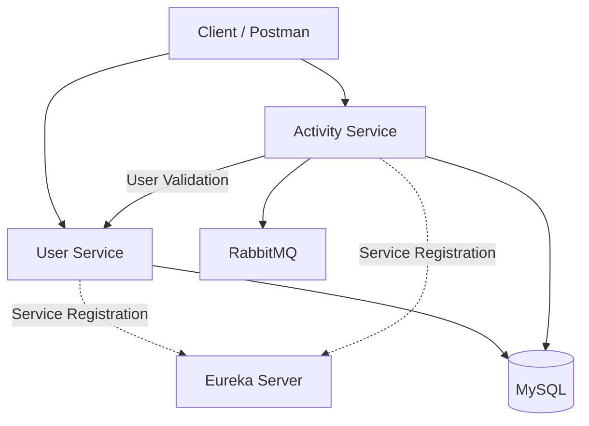

# Fitness Manager — AI-Powered Fitness Application

A microservices-based fitness management application built using Java, Spring Boot, and MySQL to manage users, track physical activities, and support personalized fitness insights.

## Overview

Fitness Manager is a backend-focused application designed to simplify fitness activity tracking through a scalable microservices architecture. It separates user management and activity tracking into independent services and uses service discovery and asynchronous messaging for inter-service communication.

## Features

- **User Management:** Manage user information through REST APIs.
- **Activity Tracking:** Record fitness activities, including activity type, duration, calories burned, start time, and additional metrics.
- **Microservices Architecture:** Separate user and activity management into independent services.
- **Service Discovery:** Register and discover services using Netflix Eureka.
- **Asynchronous Messaging:** Integrate RabbitMQ for message-based communication.
- **Database Integration:** Persist application data using Spring Data JPA, Hibernate, and MySQL.
- **User Validation:** Validate user references when processing fitness activities.
- **AI-Powered Fitness Insights:** Planned enhancement for personalized fitness recommendations.

## Tech Stack

- **Language:** Java
- **Backend:** Spring Boot, Spring Web
- **Database:** MySQL
- **ORM:** Spring Data JPA, Hibernate
- **Service Discovery:** Netflix Eureka
- **Message Broker:** RabbitMQ
- **Build Tool:** Maven
- **API Testing:** Postman
- **Version Control:** Git and GitHub

## Architecture

The application consists of independent services that communicate through REST APIs and asynchronous messaging where configured.

- **User Service:** Handles user-related operations and user validation.
- **Activity Service:** Records fitness activities, validates user references, and persists activity data.
- **Eureka Server:** Provides service registration and discovery.
- **RabbitMQ:** Supports asynchronous message communication between application components.

### Architecture Diagram



*The diagram illustrates the intended architecture. Update it to reflect the actual database configuration and message consumers in your implementation.*

## Project Structure

```text
fitness_microservices/
├── userservice/
│   └── userservice/
├── activityservice/
│   └── activityservice/
├── eureka/
└── README.md
```

Each service contains its own Maven configuration and application source code.

## Getting Started

### Prerequisites

- Java JDK compatible with the project configuration
- Maven
- MySQL Server
- RabbitMQ
- Git
- Postman

### 1. Clone the Repository

```bash
git clone <YOUR_GITHUB_REPOSITORY_URL>
cd fitness_microservices
```

### 2. Configure the Database

Create the required MySQL database and configure the database connection in each service's application configuration.

Example:

```properties
spring.datasource.url=${DB_URL}
spring.datasource.username=${DB_USERNAME}
spring.datasource.password=${DB_PASSWORD}
```

Set the corresponding environment variables in your local environment. Do not commit database credentials or other secrets to GitHub.

### 3. Configure RabbitMQ

Start RabbitMQ and configure the connection, exchange, routing key, queues, and bindings required by the application.

### 4. Run the Services

Start the Eureka Server first, followed by the User Service and Activity Service.

From each service's Maven project directory, run:

```bash
mvn clean verify
mvn spring-boot:run
```

Ensure the required database and messaging services are running before starting the application.

### 5. Test the APIs

Use Postman to test the available endpoints, verify request and response formats, and check error handling and service communication.

## Sample Activity Request

Example request body for an activity endpoint that accepts the `ActivityRequest` structure:

```json
{
  "userId": "user-123",
  "type": "RUNNING",
  "duration": 30,
  "caloriesBurned": 250,
  "startTime": "2026-10-27T07:30:00",
  "additionalMetrics": {
    "distanceKm": 4.5
  }
}
```

Use an activity type supported by your application's `ActivityType` enum.

## Testing

Run the following command in each service's Maven project directory:

```bash
mvn clean verify
```

Recommended testing areas include activity creation, user validation, database persistence, API error handling, and asynchronous messaging.

## Future Enhancements

- AI-powered fitness recommendations
- Activity history and progress analytics
- Authentication and role-based authorization
- Automated unit and integration testing
- Docker-based deployment
- CI/CD with GitHub Actions
- API documentation using OpenAPI

## License

Add an appropriate license if you intend to permit others to reuse or distribute this project.

## Author

**Ankita Awatade**

GitHub: [Add your GitHub profile or repository link]

Live Demo: To be added after deployment.
